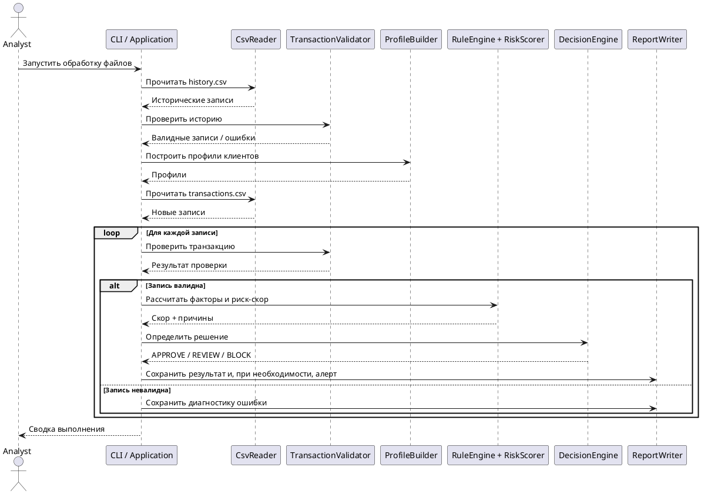
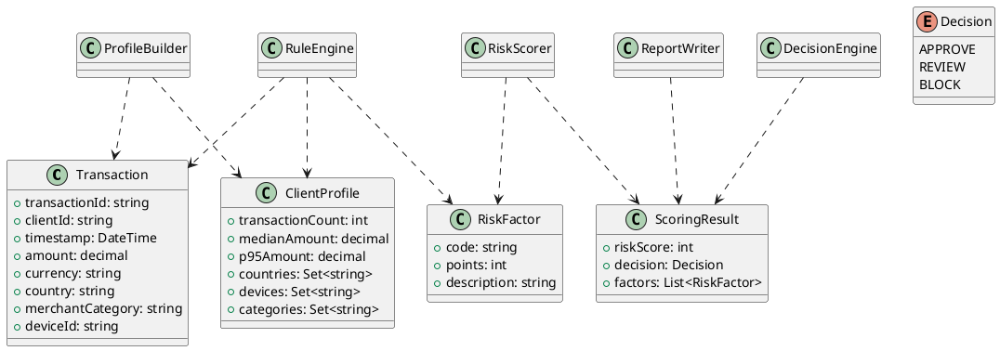

# Видение проекта: анти-фрод скоринг-движок

**Рабочее название:** FraudGuard  
**Тип проекта:** учебный прототип для предметной области «экономика и финансы»  
**Основной сценарий:** обработка ленты платёжных транзакций, оценка риска мошенничества и формирование отчёта алертов.  
**Статус документа:** начальная версия видения проекта; уточняется по мере проектирования и реализации.

---

## 1. Краткое описание

FraudGuard — учебная система из трёх реализаций скоринга: пакетное C++17-приложение, Kotlin/Swing Desktop и Dart/Flutter Web. C++ принимает CSV-файл новых транзакций и, при наличии, файл истории клиентов. Kotlin повторяет ту же бизнес-логику, показывает синтетические транзакции в имитированной живой ленте, предоставляет очередь ручной проверки `REVIEW` и вызывает собранную C++-версию для пакетного анализа. Dart/Flutter Web предоставляет аналогичную браузерную панель для демонстрации потока, ручной проверки и экспорта отчётов. Для каждой новой транзакции движок проверяет корректность данных, применяет набор объяснимых правил, сравнивает операцию со статистическим профилем клиента, рассчитывает риск-скор от 0 до 100 и выносит рекомендацию:

- **`APPROVE`** — риск низкий, транзакция может быть одобрена;
- **`REVIEW`** — есть подозрительные признаки, нужна дополнительная проверка;
- **`BLOCK`** — риск высокий, транзакция предлагается к блокировке.

Результаты сохраняются в файл отчёта. Для решений `REVIEW` и `BLOCK` создаются алерты с указанием обнаруженных факторов риска. Система предназначена для учебной демонстрации принципов антифрод-аналитики, а не для принятия реальных банковских решений.

## 2. Проблема и обоснование

Платёжные системы обрабатывают большое количество операций. Ручная проверка каждой транзакции увеличивает время обработки, а простые фиксированные ограничения могут пропускать необычные операции или создавать слишком много ложных срабатываний.

Проект демонстрирует подход, при котором несколько признаков объединяются в единый скоринг: отдельные правила выявляют известные подозрительные ситуации, а профиль клиента помогает заметить отклонения от его обычного поведения. Человек получает не только итоговый балл, но и понятные причины срабатывания.

## 3. Цель и задачи

### Цель

Разработать небольшой, модульный и тестируемый антифрод-движок, который воспроизводимо обрабатывает транзакции из файлов, оценивает риск и формирует объяснимый отчёт.

### Задачи

1. Определить входные данные, бизнес-правила, решения и критерии приёмки.
2. Спроектировать основные сценарии, классы, последовательность обработки и архитектуру модулей.
3. Реализовать ядро на C++ с валидацией, расчётом риска, обработкой ошибок и файловым вводом-выводом.
4. Перенести ту же бизнес-логику на Kotlin, добавить Swing-интерфейс с выбором файлов, имитацией потока, очередью `REVIEW` и журналом решений оператора; из интерфейса поддержать запуск C++ batch-движка.
5. Дополнительно реализовать независимый Dart-порт скоринга и аналогичный веб-интерфейс на Flutter Web; эта часть расширяет исходное требование о Kotlin-портировании, а не заменяет его.
6. Покрыть правила, пороговые значения и ошибки unit- и граничными тестами.
7. Подготовить репозиторий, README, историю изменений и презентацию для защиты на 7–10 минут.

## 4. Пользователи и заинтересованные стороны

| Роль | Потребность |
|---|---|
| Аналитик антифрода | Видеть подозрительные операции, риск-скор и конкретные причины алерта. |
| Оператор проверки | Получать список транзакций со статусом `REVIEW`, чтобы определить дальнейшие действия. |
| Разработчик / сопровождающий | Менять правила и пороги, воспроизводить результаты и добавлять тесты. |
| Преподаватель / проверяющий | Проверить архитектуру, корректность расчётов, качество тестов и использование C++/Kotlin/Dart/Git. |

## 5. Объём проекта

### Входит в MVP

- чтение входных CSV-файлов;
- проверка обязательных полей и корректности значений;
- построение статистического профиля на основе исторических операций;
- применение объяснимых правил антифрода;
- вычисление итогового риск-скора в диапазоне 0–100;
- присвоение решения `APPROVE`, `REVIEW` или `BLOCK`;
- формирование отчёта по всем транзакциям и отдельного списка алертов;
- обработка ошибочных строк и файловых ошибок;
- C++ batch-запуск из командной строки и из Kotlin-интерфейса;
- Kotlin/Swing GUI с выбором файлов, настраиваемой скоростью имитации, паузой и живой лентой;
- очередь `REVIEW` с действиями оператора «Одобрить» / «Отклонить» и отдельным журналом решений;
- реализация эквивалентной бизнес-логики на Kotlin и сравнение с эталонными результатами;
- дополнительный Dart/Flutter Web-интерфейс с локальной обработкой CSV, живой лентой, очередью `REVIEW` и экспортом отчётов.

### Не входит в MVP

- подключение к реальному банку, процессингу или платёжному шлюзу;
- автоматическая блокировка реальных платежей;
- машинное обучение и обучение моделей на размеченных данных;
- интерфейс пользователя промышленного уровня;
- распределённая обработка потоков в реальном времени;
- интеграция с внешними базами данных, антифрод-провайдерами или устройствами;
- хранение настоящих персональных и платёжных данных.

## 6. Основные пользовательские истории

**US-01 — Загрузка транзакций.**  
Как аналитик, я хочу передать CSV-файл новых транзакций, чтобы обработать набор операций без ручного ввода каждой записи.

**US-02 — Учёт привычного поведения.**  
Как аналитик, я хочу сравнивать операции клиента с его историческим профилем, чтобы замечать необычные суммы и новые характеристики транзакции.

**US-03 — Понятное решение.**  
Как оператор, я хочу получать решение, риск-скор и причины срабатывания, чтобы понимать, почему операция направлена на проверку или блокировку.

**US-04 — Отчёт алертов.**  
Как аналитик антифрода, я хочу получить отдельный файл подозрительных операций, чтобы быстро просмотреть случаи с повышенным риском.

**US-05 — Контролируемая обработка ошибок.**  
Как сопровождающий, я хочу видеть номера и причины некорректных строк, чтобы исправлять входные данные без необъяснимого завершения программы.

**US-06 — Сопоставимость реализаций.**  
Как проверяющий, я хочу запускать одинаковые тестовые данные на C++ и Kotlin, чтобы убедиться, что перенос сохраняет бизнес-логику.

## 7. Функциональные требования

| ID | Требование | Приоритет |
|---|---|---|
| FR-01 | Программа должна читать CSV с транзакциями и проверять наличие обязательных полей. | Must |
| FR-02 | Программа должна поддерживать отдельный необязательный CSV-файл истории операций. | Must |
| FR-03 | Программа должна отклонять некорректные записи с диагностикой, не аварийно завершая обработку всего файла. | Must |
| FR-04 | Для каждого клиента должен строиться доступный статистический профиль по историческим операциям. | Must |
| FR-05 | Каждая валидная новая транзакция должна оцениваться по правилам и статистическим признакам. | Must |
| FR-06 | Риск-скор должен быть целым числом в диапазоне от 0 до 100. | Must |
| FR-07 | По риск-скору программа должна назначать ровно одно решение: `APPROVE`, `REVIEW` или `BLOCK`. | Must |
| FR-08 | Для каждого срабатывания правила необходимо сохранять код или понятное название причины. | Must |
| FR-09 | Программа должна формировать полный отчёт по обработанным транзакциям. | Must |
| FR-10 | Для транзакций со статусами `REVIEW` и `BLOCK` должен формироваться отдельный отчёт алертов. | Must |
| FR-11 | Программа должна выводить сводную статистику: количество обработанных строк, ошибок, решений каждого типа и алертов. | Should |
| FR-12 | Одинаковые входные данные и конфигурация должны давать одинаковые результаты. | Must |
| FR-13 | Kotlin-реализация должна использовать те же правила, ограничения и пороги, что и версия C++. | Must |
| FR-14 | Kotlin GUI должен позволять выбрать входные CSV-файлы и папку отчётов, а также воспроизводить транзакции в живой ленте с настройкой интервала и паузой. | Must |
| FR-15 | Транзакции с рекомендацией `REVIEW` должны попадать в очередь, где оператор может одобрить или отклонить запись. | Must |
| FR-16 | Система должна раздельно сохранять исходную рекомендацию скоринга и действие оператора. | Must |
| FR-17 | Из Kotlin GUI должен запускаться собранный C++ batch-движок, если его исполняемый файл доступен. | Should |
| FR-18 | Дополнительная Dart-реализация должна использовать те же правила, веса, пороги и формат входных CSV, что и C++/Kotlin. | Should |
| FR-19 | Flutter Web должен предоставлять имитацию потока, очередь `REVIEW`, ручные решения и экспорт отчётов без серверной передачи входных файлов. | Should |

## 8. Критерии приёмки

Проект принимается, если выполнены следующие условия:

1. Программа запускается по инструкции из README и принимает пути к входным файлам и выходным отчётам.
2. Корректные транзакции обрабатываются без ручного вмешательства; результат каждой операции присутствует в полном отчёте.
3. Для каждого клиента с доступной историей рассчитываются статистические признаки, используемые в скоринге.
4. Риск-скор всегда находится в диапазоне `0..100`, а решение соответствует заданным порогам.
5. В отчёте алертов есть идентификатор транзакции, клиент, время, сумма, риск-скор, решение и причины срабатывания.
6. Отсутствующий файл, пустой файл, неизвестный клиент, некорректная сумма, неверный формат даты и неполная строка обрабатываются предсказуемо и диагностируются.
7. Unit-тесты проверяют каждое правило, границы порогов, суммирование баллов, ограничение скора, назначение решения и ошибки ввода-вывода.
8. C++- и Kotlin-версии дают одинаковые решения и одинаковые риск-скоры на общем наборе эталонных примеров (если используется одинаковая конфигурация).
9. Kotlin GUI позволяет воспроизводить поток, приостанавливать его и обрабатывать очередь `REVIEW`; действия оператора сохраняются отдельно от рекомендации движка.
10. Из Kotlin GUI можно запустить C++ batch-движок при наличии собранного исполняемого файла.
11. Дополнительная Dart-версия совпадает с эталонным набором и поддерживает веб-поток, очередь REVIEW и экспорт CSV.
12. В репозитории есть понятная структура каталогов, README, тесты и история коммитов; подготовлен доклад на 7–10 минут.

## 9. Входные данные и форматы файлов

Для учебного прототипа используются CSV-файлы в кодировке UTF-8. Разделитель — запятая; формат дат — ISO 8601. Денежные значения хранятся как неотрицательные числа с фиксированной точностью, а валюта указывается явно. Реальные номера карт, CVV, пароли и другие секреты не используются.

### 9.1. Новые транзакции — `transactions.csv`

| Поле | Тип / пример | Назначение |
|---|---|---|
| `transaction_id` | строка, `T10001` | Уникальный идентификатор операции. |
| `client_id` | строка, `C015` | Идентификатор клиента в учебном наборе. |
| `timestamp` | ISO 8601, `2026-10-28T12:15:00Z` | Время операции. |
| `amount` | число, `125.50` | Сумма транзакции; должна быть больше нуля. |
| `currency` | строка, `EUR` | Валюта операции. |
| `country` | строка, `DE` | Страна операции в учебном наборе. |
| `merchant_category` | строка, `electronics` | Категория торговой точки. |
| `device_id` | строка, `D008` | Псевдоним устройства, не настоящий идентификатор устройства. |

### 9.2. История — `history.csv`

История использует те же поля. Она содержит прошлые операции, доступные для построения профиля. Для учебного эксперимента предполагается, что записи в этом файле пригодны для формирования базового профиля; в реальной системе история должна быть очищена от подтверждённых мошеннических операций и снабжена контролем качества.

Если файл истории отсутствует или у клиента нет истории, движок применяет только правила, не требующие персонального профиля, и помечает профиль как `COLD_START` (недостаточно истории). Отсутствие истории само по себе не означает мошенничество.

### 9.3. Полный результат — `results.csv`

Минимальные поля: `transaction_id`, `client_id`, `timestamp`, `amount`, `currency`, `risk_score`, `decision`, `risk_factors`, `profile_status`, `processing_status`.

### 9.4. Диагностика ошибок — `errors.csv`

Для каждой ошибочной строки сохраняются `source_file`, `line_number`, `transaction_id` (если его удалось прочитать), `error_code` и `message`. Отдельная ошибочная строка не должна останавливать обработку валидных строк. Ошибка схемы (например, отсутствует обязательный столбец) считается ошибкой файла и диагностируется отдельно.

### 9.5. Отчёт алертов — `alerts.csv`

Включает транзакции с решениями `REVIEW` и `BLOCK`. Помимо полей полного результата, рекомендуется добавить `alert_id` и человекочитаемое описание факторов риска. Транзакции `APPROVE` в отчёт алертов не включаются, но остаются в `results.csv`.

## 10. Предлагаемая логика скоринга

### 10.1. Общий принцип

Скоринг объединяет баллы сработавших правил. Значения ниже являются начальными параметрами учебного прототипа, а не отраслевым стандартом. Пороговые значения и веса должны быть вынесены в конфигурацию или централизованные константы, чтобы их можно было менять без переписывания бизнес-логики.

**Итоговый скор:**

`risk_score = min(100, сумма баллов всех сработавших правил)`

Каждое правило возвращает не только баллы, но и код причины. Если несколько правил сработали одновременно, причины сохраняются все, а итоговый скор ограничивается сверху значением 100.

### 10.2. Начальный набор правил

| Код | Условие срабатывания | Баллы | Причина в отчёте |
|---|---|---:|---|
| `HIGH_AMOUNT` | Сумма не менее чем в 5 раз выше медианы сумм клиента при достаточной истории. | 30 | Сумма значительно превышает обычный уровень клиента. |
| `UNUSUAL_AMOUNT` | Сумма выше 95-го перцентиля исторических сумм клиента, но не удовлетворяет более строгому условию `HIGH_AMOUNT`. | 15 | Сумма необычно высока относительно истории клиента. |
| `HIGH_VELOCITY` | У клиента обнаружено 5 или более попыток транзакций за скользящее окно в 10 минут. | 25 | Слишком много операций за короткий промежуток времени. |
| `NEW_COUNTRY` | Страна не встречалась в доступной истории клиента при достаточном количестве исторических операций. | 20 | Новая для клиента страна операции. |
| `NEW_DEVICE` | Устройство отсутствует в доступной истории клиента при достаточном количестве исторических операций. | 15 | Неизвестное ранее устройство. |
| `NEW_CATEGORY` | Категория торговой точки не встречалась в доступной истории клиента при достаточном количестве исторических операций. | 10 | Новая категория торговой точки. |

Правила `HIGH_AMOUNT` и `UNUSUAL_AMOUNT` взаимоисключающие: за одну и ту же необычную сумму не начисляются оба балла. Для перцентиля в небольшой учебной реализации допустима простая сортировка исторических сумм; выбранный метод вычисления перцентиля следует описать в коде и покрыть тестом.

`HIGH_VELOCITY` рассчитывается по валидным новым транзакциям из текущего входного файла: учитываются операции клиента в закрытом интервале [timestamp − 10 минут, timestamp], включая текущую операцию; исторические строки в частотное окно MVP не включаются. Окно определяется по времени, поэтому тесты должны явно проверять операции на границе 10 минут. Все валидные операции из входного файла учитываются независимо от вынесенного решения.

### 10.3. Решения по порогам

| Диапазон риск-скора | Решение | Интерпретация |
|---|---|---|
| `0–29` | `APPROVE` | Низкий риск по реализованным правилам. |
| `30–59` | `REVIEW` | Требуется дополнительная проверка. |
| `60–100` | `BLOCK` | Высокий риск; прототип рекомендует блокировку. |

Пороговые значения условны и предназначены для демонстрации механизма принятия решений. Балл — это не вероятность мошенничества и сам по себе не доказывает факт мошенничества. В промышленной системе пороги калибруются на размеченных данных, контролируются бизнесом и проверяются с учётом ложноположительных и ложноотрицательных срабатываний.

### 10.4. Статистический профиль клиента

Для каждого клиента из истории рекомендуется вычислять:

- количество исторических транзакций;
- медиану суммы;
- 95-й перцентиль суммы;
- множество встречавшихся стран;
- множество встречавшихся устройств;
- множество встречавшихся категорий торговых точек.

Для защиты от ложных выводов в MVP ввести параметр `MIN_HISTORY_SIZE` (например, 5 операций). Если история меньше этого значения, сравнения, требующие устойчивой статистики, не применяются. В этом случае движок использует независимые от персонального профиля правила, а в результате указывает `COLD_START` или `LIMITED_HISTORY`.

## 11. Обработка ошибок и спорных ситуаций

| Ситуация | Ожидаемое поведение |
|---|---|
| Нет обязательного столбца в заголовке | Завершить обработку соответствующего файла с понятной ошибкой схемы. Не создавать молча некорректный отчёт. |
| Отсутствует необязательный файл истории | Продолжить обработку в режиме без истории и зафиксировать предупреждение. |
| Нет обязательного значения в строке | Пометить строку как невалидную, записать номер строки и причину в журнал ошибок, продолжить чтение остальных строк. |
| Сумма равна нулю, отрицательна или не является числом | Не выполнять скоринг этой строки; отметить ошибку валидации. |
| Дублируется `transaction_id` | Не обрабатывать дубликат повторно; отразить проблему в диагностике. Правило уникальности должно быть документировано. |
| Неизвестный клиент в файле истории | Не считать это ошибкой само по себе; создать профиль из имеющихся записей или применить режим `COLD_START`. |
| Не удалось открыть файл или записать отчёт | Вывести сообщение с путём и причиной, вернуть ненулевой код завершения. |
| Неожиданная внутренняя ошибка | Не выдавать ложное решение `APPROVE`; вывести диагностику и завершить обработку безопасным образом. |

Для перцентиля в MVP используется метод ближайшего ранга: после сортировки n значений индекс равен ceil(p*n)-1 для p от 0 до 1. При расчёте медианы для чётного количества значений берётся среднее двух центральных значений. В MVP предполагается, что все суммы приводятся к одной валюте либо сравниваются только в рамках одинаковой валюты. Сравнение сумм разных валют без конвертации недопустимо. Если поддержка нескольких валют реализуется, статистический профиль должен учитывать валюту.

## 12. Архитектура модулей

Приложение строится как небольшое консольное приложение с разделением ввода-вывода, доменной логики и скоринга.

| Модуль | Ответственность |
|---|---|
| `CsvReader` | Чтение CSV, разбор заголовка и строк, сообщения об ошибках формата. |
| `TransactionValidator` | Проверка обязательных полей, суммы, времени, валюты и уникальности идентификатора. |
| `ProfileBuilder` | Построение профиля клиента из истории. |
| `RuleEngine` | Проверка отдельных антифрод-правил и возврат факторов риска. |
| `RiskScorer` | Суммирование баллов и ограничение результата диапазоном 0–100. |
| `DecisionEngine` | Преобразование риск-скора в `APPROVE`, `REVIEW` или `BLOCK`. |
| `ReportWriter` | Запись полного отчёта, алертов и сводной статистики. |
| `Application` / `main` | Чтение аргументов командной строки и координация этапов обработки. |

### Поток обработки

1. Прочитать аргументы запуска и проверить доступность файлов.
2. Загрузить и провалидировать историю.
3. Построить профили клиентов.
4. Прочитать новые транзакции; проверить каждую строку.
5. Для валидных строк вычислить признаки, применить правила и получить риск-скор.
6. Назначить решение по порогам.
7. Записать строку в `results.csv`; для `REVIEW` и `BLOCK` дополнительно записать алерт в `alerts.csv`.
8. Вывести сводку и статус выполнения.

### Упрощённая диаграмма последовательности (PlantUML)



### Упрощённая диаграмма классов (PlantUML)



### Use Case (упрощённо)

**Актор:** аналитик антифрода.  
**Основной сценарий:** указать входные файлы → запустить анализ → просмотреть сводку → изучить `alerts.csv` → при необходимости проверить причины по каждой транзакции.  
**Альтернативные сценарии:** ошибки схемы файла останавливают обработку этого файла; некорректные отдельные строки пропускаются с диагностикой; отсутствие истории переводит скоринг в режим холодного старта.

Для отчётной работы Use Case можно дополнительно оформить отдельной UML-диаграммой в draw.io или PlantUML.

## 13. Интерфейс командной строки

Предлагаемый формат запуска C++-версии:

```text
fraudguard --input data/transactions.csv --history data/history.csv \
  --results reports/results.csv --alerts reports/alerts.csv \
  --errors reports/errors.csv
```

Аргумент `--history` необязателен. Для воспроизводимости пороги и веса должны иметь значения по умолчанию и документироваться в README; расширенный вариант может принимать конфигурационный файл.

Пример итоговой сводки в консоли:

```text
Всего строк: 120
Валидных транзакций: 116
Ошибок валидации: 4
APPROVE: 82
REVIEW: 25
BLOCK: 9
Алертов записано: 34
```

Числа выше приведены только как пример формата, а не как результат реального запуска.

## 14. Нефункциональные требования

- **Понятность:** каждое правило и каждый порог описаны в документации.
- **Детерминированность:** одинаковые данные и настройки дают одинаковые результаты.
- **Модульность:** чтение файлов, валидация, профиль, скоринг и отчёты разделены по компонентам.
- **Тестируемость:** бизнес-логика может тестироваться без обращения к файловой системе.
- **Надёжность:** ошибка одной строки не должна без причины останавливать обработку всего файла.
- **Переносимость:** C++-версия компилируется стандартным компилятором C++17 или новее; Kotlin-версия запускается через стандартную JVM-инфраструктуру проекта.
- **Минимизация данных:** используются учебные псевдонимы и синтетические данные; секретные данные платёжных карт не сохраняются.
- **Производительность учебного прототипа:** на обычном учебном ноутбуке пакет из нескольких тысяч строк обрабатывается без заметных задержек; точное ограничение следует проверить экспериментом и указать в отчёте.

## 15. План тестирования

### 15.1. Unit-тесты

| Область | Что проверяется |
|---|---|
| Валидация | Обязательные поля, сумма, формат даты, пустые значения, неизвестный формат валюты. |
| Профиль клиента | Медиана, 95-й перцентиль, количество истории, новые страны/устройства/категории. |
| Правила | Каждое правило отдельно: условие до границы, на границе и после границы. |
| Скоринг | Суммирование баллов, взаимоисключение двух правил суммы, ограничение максимума до 100. |
| Решения | Скор 29 → `APPROVE`, 30 → `REVIEW`, 59 → `REVIEW`, 60 → `BLOCK`, 100 → `BLOCK`. |
| Velocity | 4 операции в окне, 5 операций в окне, операция ровно на границе окна, разные клиенты. |
| Холодный старт | Клиент без истории и клиент с историей меньше `MIN_HISTORY_SIZE`. |
| Отчёты | Поля CSV, корректное экранирование, наличие алертов только для `REVIEW` и `BLOCK`. |
| Ошибки ввода-вывода | Нет файла, нет прав на запись, пустой файл, неполная строка, дубликат ID. |
| Межъязыковая совместимость | Совпадение скоринга на эталонном наборе для C++ и Kotlin. |

### 15.2. Граничные и интеграционные случаи

- риск-скор точно на каждом пороге принятия решения;
- сумма точно равна 3× и 5× медиане;
- операция по времени точно на границе окна 10 минут;
- очень маленькая и очень большая сумма;
- несколько правил одновременно дают сумму больше 100;
- история отсутствует или содержит ровно `MIN_HISTORY_SIZE - 1`, `MIN_HISTORY_SIZE` и `MIN_HISTORY_SIZE + 1` записей;
- два клиента с одинаковыми суммами, но разной историей стран и устройств;
- неверная строка между двумя корректными строками;
- файл содержит только заголовок или полностью пуст;
- повторный запуск на тех же входных данных создаёт тот же результат.

### 15.3. Отчёт о дефектах

Для каждого найденного дефекта рекомендуется фиксировать: ID, краткое описание, шаги воспроизведения, ожидаемое поведение, фактическое поведение, серьёзность, исправление и тест, предотвращающий повторение. Реальные найденные дефекты в документе не выдумываются — они вносятся после выполнения тестов.

## 16. Реализация на C++ и Kotlin

### C++ — основное ядро

- стандарт языка: C++17 или новее;
- ориентировочный объём бизнес-модуля: 150–300 строк, как указано в задании;
- классы и структуры соответствуют доменным сущностям и модулям архитектуры;
- скоринг и правила не смешиваются с чтением CSV;
- ошибки обрабатываются явно; тестируемая логика по возможности не зависит от консольного ввода-вывода.

### Kotlin — перенос / расширение

Для наиболее содержательного сравнения рекомендуется перенести бизнес-логику скоринга на Kotlin: модели транзакций и профилей, валидацию, правила, вычисление скора и решение. Формат CSV и набор эталонных тестовых примеров должны совпадать с C++-версией.

В сравнении описать:

- модели данных и типы;
- работу с коллекциями и датами;
- обработку ошибок и nullable-значений;
- организацию unit-тестов;
- читаемость, объём кода и удобство изменений;
- подтверждённые различия поведения, если они обнаружены тестами.

Не следует делать вывод о превосходстве языка по скорости без измерений на одинаковых данных и в одинаковых условиях.

### Dart — дополнительный веб-порт

Dart/Flutter Web является расширением проекта сверх исходного требования о Kotlin. Он повторяет алгоритм скоринга на том же CSV-контракте, показывает демонстрационную ленту и ручную очередь `REVIEW` в браузере. Выбранные файлы обрабатываются локально во вкладке, а отчёты скачиваются браузером. По соображениям безопасности браузер не запускает локальный `fraudguard.exe`; возможность запуска C++ batch остаётся в Kotlin Desktop и CLI.

## 17. Репозиторий и организация работ

Пример структуры проекта:

```text
fraudguard/
├── README.md
├── VISION.md
├── docs/
│   ├── requirements.md
│   ├── architecture.md
│   └── uml/
├── cpp/
│   ├── src/
│   ├── include/
│   └── tests/
├── kotlin/
│   ├── src/main/
│   └── src/test/
├── data/
│   ├── history.csv
│   ├── transactions.csv
│   └── expected-results.csv
└── .gitignore
```

Предлагаемая схема веток: `main` — стабильная версия; `develop` — интеграционная ветка, если она нужна команде; `feature/requirements`, `feature/cpp-engine`, `feature/kotlin-port`, `feature/tests` — тематические ветки. Каждый PR/MR должен содержать описание изменений, результаты тестов и ссылку на связанный пункт требований или задачу. Для индивидуального проекта допустим упрощённый процесс: тематические ветки и небольшие осмысленные коммиты с последующим слиянием в `main`.

## 18. Этапы выполнения по заданию

| Этап | Работы в рамках FraudGuard | Результат |
|---|---|---|
| 1. Требования | Уточнить входные данные, правила, роли, User Stories, функциональные требования и критерии приёмки. | `VISION.md` и/или `requirements.md` (SRS). |
| 2. Проектирование | Подготовить Use Case, Class и Sequence в упрощённом виде; описать связи модулей. | UML-диаграммы и описание архитектуры. |
| 3. Реализация ядра | Написать обработку CSV, валидацию, профиль клиента, правила, скоринг, решения и отчёты на C++. | Рабочий модуль объёмом 150–300 строк бизнес-логики. |
| 4. Портирование / расширение | Реализовать ту же логику на Kotlin и сравнить с C++ на эталонных примерах. | Kotlin-код и краткое сравнение языков. |
| 5. Тестирование | Написать unit-, граничные и интеграционные тесты; устранить дефекты. | Набор тестов и отчёт о дефектах. |
| 6. Git + защита | Оформить репозиторий, README, ветки/PR, демонстрационный набор данных и презентацию. | GitHub/GitLab и доклад на 7–10 минут. |

## 19. Риски и ограничения

| Риск | Последствие | Снижение риска |
|---|---|---|
| Мало исторических данных | Статистические признаки ненадёжны. | Ввести `MIN_HISTORY_SIZE` и режим холодного старта. |
| Слишком простые правила | Возможны ложные срабатывания и пропуски мошенничества. | Явно обозначить учебный характер и тестировать примеры разных типов. |
| Перекрывающиеся правила | Один признак может непропорционально повышать скор. | Сделать правила суммы взаимоисключающими и покрыть это тестом. |
| Различия C++ и Kotlin | Результаты двух реализаций могут расходиться. | Использовать один эталонный набор входных данных и проверять результаты автоматически. |
| Ошибки данных CSV | Некорректные решения или падение программы. | Проверять схему, валидировать каждую строку и тестировать ошибочные файлы. |
| Смешение валют | Некорректное сравнение величин. | Сравнивать только одну валюту либо разделять профили по валютам. |
| Неверная трактовка риск-скора | Балл может восприниматься как доказанная вероятность мошенничества. | Показывать причины, документировать условность баллов и не называть скор вероятностью. |

## 20. Предположения и открытые вопросы

В первой версии принимаются следующие решения:

- формат файлов — CSV в UTF-8;
- даты — ISO 8601;
- для демонстрационного набора используется EUR или другая одна согласованная валюта;
- C++-ядро является основной реализацией, Kotlin повторяет его бизнес-логику;
- начальные баллы и пороги из раздела 10 — настройки учебной версии, а не универсальные правила финансовой индустрии;
- решение `BLOCK` означает рекомендацию прототипа, а не фактическое воздействие на платёж;
- все данные для демонстрации синтетические.

В базовой версии ошибки строк сохраняются в отдельный `errors.csv`; веса и пороги фиксированы в требованиях и едины для C++ и Kotlin. Вынесение порогов в конфигурационный файл можно рассматривать как расширение, если останется время. Use Case оформляется отдельной диаграммой в рамках этапа проектирования.

## 21. Definition of Done — критерии завершения проекта

Проект можно считать завершённым, когда:

- требования и UML-диаграммы подготовлены и согласованы с кодом;
- C++-приложение компилируется и выполняет полный сценарий обработки;
- результаты и алерты записываются в документированные CSV-форматы;
- предусмотрены ошибки входных данных и файловых операций;
- тесты проходят, а найденные дефекты задокументированы;
- Kotlin-версия проверена на том же наборе примеров;
- README содержит зависимости, инструкцию сборки, запуск, формат данных и пример результата;
- репозиторий имеет понятную историю изменений;
- демонстрация и доклад укладываются в 7–10 минут.

---

**Важно:** FraudGuard — учебная модель принятия решений. Реальный антифрод требует контроля качества данных, измерения ложноположительных и ложноотрицательных результатов, мониторинга дрейфа поведения, защиты данных, аудита решений и проверки соответствия применимым требованиям законодательства и организации.
